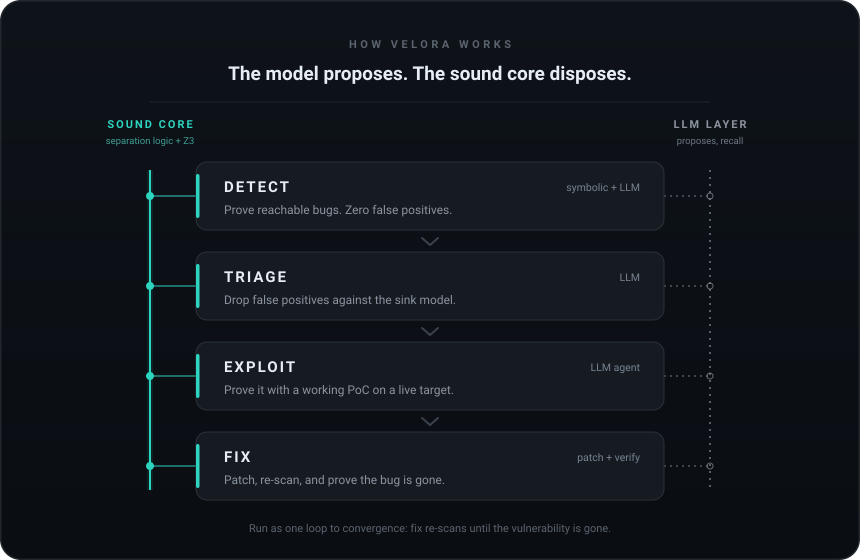

# Velora

[](https://github.com/manojxshrestha/velora/actions/workflows/tests.yml)
[](LICENSE)
[](https://www.python.org/downloads/)

Velora is a neuro-symbolic security agent. A sound static-analysis core — taint analysis plus separation-logic verification with Z3 — is fused with an LLM layer in one loop: **the model proposes, the sound core disposes.**

It runs the whole loop end to end: detect vulnerabilities across 5 languages, exploit them with a working proof-of-concept against a live target, fix the code, then re-scan to confirm the bug is gone. Symbolic findings are proven, not guessed; LLM findings are tiered separately so the two are never confused. On independent real-world benchmarks Velora is competitive with commercial AI-SAST vendors, and it scores 80%+ on the synthetic OWASP suites. The LLM layer runs on any OpenAI-compatible endpoint — local or hosted, including a **zero-key free tier** (`velora setup`).

**Contents** — [Installation](#installation) · [Setup](#setup) · [Quick Start](#quick-start) · [Usage](#usage) · [Commands](#commands) · [Languages](#supported-languages) · [Detectors](#what-velora-detects) · [How It Works](#how-it-works) · [AI Layer](#ai-assisted-detection--triage) · [RAM & Models](#ram--model-requirements) · [Model Providers](#model-providers) · [Python API](#python-api) · [Symbolic Core](#the-symbolic-core-separation-logic--z3)

## Highlights

- **Sound by construction.** The symbolic core proves reachability with Z3 — its findings carry no false positives — and never conflates them with LLM-tier results.
- **One CLI, the whole loop.** `scan` → `exploit` → `fix`, composed over a shared findings file.
- **Five symbolic frontends** (Python, Java, JS/TS, C/C++, C#) plus an LLM tier for any other language.
- **Zero-key AI.** `velora setup` bootstraps a local bridge to opencode's free Zen tier — no API key is ever stored.
- **Separation-logic solver built in** (`velora solve`), validated on SL-COMP and SMT-LIB.

**Real-world security benchmarks**, validated on five independent datasets with published ground truth. Every Velora number uses open models (local Qwen via mlx-optiq, or hosted GLM-5.2):

| Benchmark | What it measures | Velora | Comparison |
|-----------|------------------|------|-----------|
| [XBOW / ZeroPath](benchmarks/xbow_zeropath/REPORT.md) | AI-SAST on 39 web-vuln apps | detect **78.8%**, FP **26.3%** (technical) | ties ZeroPath (80% / 25%); beats Semgrep, Snyk, Bearer |
| [CVE-Bench](benchmarks/cve_bench/README.md) | Full loop, 10 live web CVEs | detect **5/10**, exploit **4/10**, fix **4/10** | each stage verified on a live target |
| [Endor Labs corpus](benchmarks/endor_corpus/README.md) | 193 vulns, 5 production apps | recall **0.67**, precision **0.51** | Semgrep recall 0.52, precision 0.40 |
| [RealVuln IDOR/BOLA](benchmarks/realvuln_authz/REPORT.md) | Broken authorization, 4 real apps | **6/8** detected, precision **1.00** | 0 false positives on safe controls |
| [SusVibes](benchmarks/susvibes/README.md) | 181 real-CVE Python pairs | recall **0.14**, precision **0.56** | Semgrep recall 0.06, precision 0.55 |

<sub>Each cell names its own metric. SusVibes is hard for every tool (independent, execution-verified ground truth). See each benchmark's report for methods and caveats.</sub>

**OWASP score, synthetic suites** (True Positive Rate minus False Positive Rate):

| Benchmark | Velora | Semgrep | Difference |
|-----------|:---:|:---:|:---:|
| **Python** (OWASP) | 80.9% | 4.5% | +76.4 pts |
| **Java** (OWASP) | 81.5% | 15.7% | +65.8 pts |
| **JavaScript** (SecBench.js) | 43.0% | 10.0% | +33 pts |
| **C/C++** (NIST Juliet) | 54.4% | -14.9% | +69.3 pts |
| **C#** (IssueBlot.NET) | 80.3% | 14.2% | +66.1 pts |

<sub>Higher is better. See [benchmarks/](benchmarks/) for detailed methods and results.</sub>

## Installation

Requires **Python 3.10+** with `pip`. Everything installs into a virtual environment, so nothing outside it is touched.

**Standard install** — clone, virtualenv, install, verify:

```bash
git clone https://github.com/manojxshrestha/velora.git
cd velora
python3 -m venv .venv
. .venv/bin/activate
pip install -e ".[scan]"
velora --version          # -> velora 0.0.1
```

What each step does:

| Step | Purpose |
|------|---------|
| `git clone … && cd velora` | Fetch the source; run everything from the repo root |
| `python3 -m venv .venv` | Create an isolated Python environment under `.venv/` |
| `. .venv/bin/activate` | Put it on your shell's `PATH` (re-run in every new terminal) |
| `pip install -e ".[scan]"` | Install Velora in editable mode **plus the `[scan]` extra** — the tree-sitter frontends that `velora scan` needs |
| `velora --version` | Confirm the `velora` console command is available |

Already inside a virtualenv or CI runner (skip the venv step):

```bash
git clone https://github.com/manojxshrestha/velora.git && cd velora && pip install -e ".[scan]" && velora --help
```

Prefer not to clone? Install straight from GitHub — same one-liner, console command included:

```bash
pip install "velora[scan] @ git+https://github.com/manojxshrestha/velora.git"
```

**Install variants:**

| Command | What you get |
|---------|--------------|
| `pip install -e .` | Minimal: separation-logic solver (`solve`, `check`, `parse`, `repl`) only — `velora scan` will refuse with a tree-sitter install hint |
| `pip install -e ".[scan]"` | **Recommended.** Everything: all 5 symbolic language frontends for `velora scan` |
| `pip install -e ".[dev]"` | `scan` prerequisites + pytest for running the test suite |
| `pip install -e ".[all]"` | `scan` + `dev` combined |

**Verify** (all three must work):

```bash
velora --help    # lists: scan, exploit, fix, solve, check, parse, repl, models, doctor, setup, serve-bridge
velora solve "ls(x, y) * ls(y, z) * x != z |- ls(x, z)"    # -> ✓ VALID
velora scan examples/app.py                                # -> 2 CRITICAL findings; exit code 1 (high+ findings, the default --fail-on high)
```

## Setup

The symbolic engine needs **no setup** — `velora scan` (without `--ai`), `velora solve`, `check`, `parse`, and `repl` work the moment installation finishes. Only the LLM-dependent commands (`velora scan --ai`, `velora exploit`, `velora fix`) need a model endpoint. The zero-key path below gives you one without ever storing an API key.

### Zero-key quickstart (recommended)

```bash
velora setup          # one-time bootstrap (below); safe to re-run, --yes skips the prompt
velora doctor         # diagnose the setup; exit 0 when ready
velora models use opencode-bridge/opencode/mimo-v2.6-flash-free --no-prompt   # activate a free model
velora doctor --probe # end-to-end check: one real keyless chat through the bridge
```

**`velora setup`** installs whatever is missing, user-local (no sudo): Node ≥ 18 into `~/.local/opt` (symlinked into `~/.local/bin`), the `opencode` CLI, and the bridge's dependencies — then seeds and starts the bridge daemon. It is idempotent (re-running changes nothing that's already present), and `--yes` makes it non-interactive for scripts.

**`velora doctor`** checks the whole chain and exits 1 while anything is missing:

```text
velora doctor
  ✅ platform         Linux … (x86_64) WSL
  ✅ python           Python 3.14.7, velora 0.0.1, z3 5.1.0
  ✅ node             …/node (v22.23.3)
  ✅ opencode         …/opencode (1.18.34)
  ✅ bridge-sources   …/velora/_bridge
  ✅ bridge-runtime   …/share/velora/bridge (deps installed)
  ✅ bridge           healthy on :8399 (pid …)
  ✅ model            opencode-bridge/opencode/mimo-v2.6-flash-free -> http://127.0.0.1:8399/v1 [config]
  ✅ bridge-required  active model is bridge-backed and the bridge is healthy
  ✅ endpoints        bridge: 10; local down: 5/5

ready for zero-key `velora scan --ai`
```

Add `--probe` to go further and send one real keyless chat end-to-end (exit code reflects the result); `--format json` for scripts.

### The bridge

The bridge (`velora serve-bridge`) is a local OpenAI-compatible server on `http://127.0.0.1:8399/v1` that proxies opencode's own client — opencode owns every credential, so Velora stores none. Manage it directly when you don't want `velora setup`/`models tui` to do it for you:

```bash
velora serve-bridge --start     # start the daemon in the background
velora serve-bridge --status    # -> [bridge] healthy on http://127.0.0.1:8399 (pid …)   (exit 0 when healthy)
velora serve-bridge --stop      # stop it (models tui / setup restart it on demand)
velora serve-bridge             # run it in the foreground (Ctrl+C to stop)
```

The daemon logs to `$XDG_STATE_HOME/velora/bridge.log` (typically `~/.local/state/velora/bridge.log`). `velora models tui` auto-starts the bridge whenever you pick a model through it.

### Choosing a model

```bash
velora models list                # Zen catalog: free first, ✓ = usable by Velora
velora models list --free         # free models only
velora models current             # what's active and where it came from
velora models tui                 # full-screen picker (bridge + any local servers), auto-starts the bridge
velora models use zen/glm-5.2     # switch model (example ref; free bridge ref: opencode-bridge/opencode/<id>)
velora models providers           # velora config, env keys, opencode providers
```

`velora models use … --no-prompt` is the non-interactive form. Full provider walkthroughs (Zen key, models.dev registry, local servers, import-opencode) are in [Model Providers](#model-providers).

### Configuration precedence & environment variables

Model settings resolve per field in this order: **`--model` flag → `VELORA_LLM_*` environment variables → `~/.config/velora/config.json` → existing opencode config** (auto-fallback, announced once on stderr; disable with `VELORA_SKIP_PROVIDER_FALLBACK=1`). Every model-printing command tells you which source won, e.g. `using model '…' from velora config (…)`.

| Variable | Default | Purpose |
|----------|---------|---------|
| `VELORA_LLM_BASE_URL` | — | OpenAI-compatible endpoint |
| `VELORA_LLM_MODEL` | — | Model id |
| `VELORA_LLM_API_KEY` | — | API key (leave empty for local servers) |
| `VELORA_LLM_REPO_ROOT` | — | Repo root for the agentic cross-file `read_file`/`grep` tools |
| `VELORA_LLM_TIMEOUT` | `120` | Max gap (seconds) between network bytes on a model call |
| `VELORA_LLM_AGENT_TIMEOUT` | `300` | Overall budget (seconds) for one `exploit`/agent round-trip — free-tier turns of 30–90 s fit with headroom |
| `VELORA_LLM_AGENT_RETRIES` | `2` | Extra HTTP attempts inside a round-trip before it counts as a failure |
| `VELORA_SKIP_PROVIDER_FALLBACK` | — | `=1` disables the opencode config auto-fallback |

All of them accept the legacy `FRAME_LLM_*` spelling too. Defaults cover the free tier; only reach for the timeouts on unusually slow endpoints.

### Platform support

**Linux (incl. WSL) and macOS.** On native Windows, run `wsl --install` and do everything inside WSL — the bridge will not start from a Windows shell.

## Quick Start

Every command below runs as-is in a fresh clone. Copy them in order.

**1 — Scan a file.** The target for `velora scan` is a path **on your machine** (a file or a folder, never a URL). This demo file ships with the repo and is intentionally vulnerable:

```bash
velora scan examples/app.py
# -> Vulnerabilities Found: 2
#    1. [CRITICAL] sql_injection     login  examples/app.py:20  CWE-89
#    2. [CRITICAL] command_injection run    examples/app.py:27  CWE-78     ~10 ms, no model needed
```

**2 — Scan a folder.** Point `velora scan` at any project directory. A folder scan picks Python files by default (`**/*.py` = “any `.py` file, here or in any subfolder”); `--pattern` changes which files it picks:

```bash
velora scan .                                  # the folder you are standing in right now
velora scan /path/to/your/project              # any directory on your machine
velora scan /path/to/your/project --pattern "**/*.java"   # only its Java files
```

**3 — Scan with AI.** `--ai` adds LLM detection + triage on top of the symbolic engine. One-time model setup first (zero-key, no API key needed):

```bash
velora setup                                   # installs & starts the local model bridge
velora models use opencode-bridge/opencode/mimo-v2.6-flash-free --no-prompt   # pick the free model
velora scan . --ai
```

**4 — Built-in separation-logic solver.** Velora's soundness core, exposed directly — ask whether one heap description implies another, e.g. “two joined list segments (whose ends differ) imply one whole list”:

```bash
velora solve "ls(x, y) * ls(y, z) * x != z |- ls(x, z)"   # prints: VALID
```

Anatomy of a scan command:

| Piece | Meaning |
|---|---|
| `examples/app.py` or `.` | **the target** — a file/folder path on your machine (not a URL) |
| `.` vs `/path/to/project` | `.` = current directory; any absolute or relative path works |
| `--pattern "**/*.java"` | file filter inside the folder (`**` = every subfolder; default `**/*.py`) |
| `--ai` | add the LLM detect + triage layer (needs a model — step 3) |
| `-f json -o findings.json` | write findings as JSON (feeds `exploit` / `fix`) |
| `--format sarif` / `--fail-on high` | CI output format / minimum severity that fails the build |

<details>
<summary><strong>More examples</strong></summary>

```bash
# Any language, LLM tier only (no symbolic frontend)
velora scan /path/to/project --pattern "**/*.go" --ai -l go

# CI/CD gate (SARIF output)
velora scan . --format sarif -o results.sarif --fail-on high

# Exploit a finding against a live, authorized target (primed by a scan)
velora exploit --target http://localhost:8080 --guidance findings.json

# Generate a fix, then re-scan to confirm the vulnerability is gone
velora fix examples/app.py --guidance findings.json --diff

# Solver extras
velora check formulas.txt    # batch-check a file
velora repl                  # interactive REPL
```

</details>

## Usage

### Scan source code

**The target for `velora scan` is a path on your machine** — a source file or a project directory you have locally. It is *not* a URL (URLs are targets for `velora exploit --target`, see below). Passing a path that doesn't exist gives:

```text
Error: Target not found: ./repo
```

Either run `velora scan` from inside your project directory, or pass an absolute path.

A guided first run — these exact commands work in a fresh clone:

```bash
# 1. Scan the bundled intentionally-vulnerable demo (ships with the repo)
velora scan examples/app.py
#    -> [CRITICAL] sql_injection    (CWE-89) examples/app.py:20
#       [CRITICAL] command_injection (CWE-78) examples/app.py:27
#       ~10 ms, no model needed

# 2. Scan your own project. "." = current directory, --pattern picks the files.
#    (Replace the path with wherever YOUR code lives.)
velora scan . --pattern "**/*.py"
velora scan . --pattern "**/*.java"        # only .java files (a project that has them; the repo has none -> "No files found")

# 3. Machine-readable findings (input for the exploit/fix stages)
velora scan . --pattern "**/*.py" -f json -o findings.json

# 4. Add the AI layer (LLM detection + triage) -- one-time model setup first:
velora setup                               # zero-key quickstart, see Model Providers
velora models use opencode-bridge/opencode/mimo-v2.6-flash-free --no-prompt
velora scan . --ai

# 5. CI gate: fail the build on high+ findings (SARIF for code-scanning UIs)
velora scan . --format sarif -o results.sarif --fail-on high
```

Symbolic scans (no `--ai`) finish in milliseconds to seconds and never need a model. Each `--ai` file costs one or more LLM calls — seconds on a fast endpoint, tens of seconds on the free tier.

| Goal | Command |
|------|---------|
| Scan a single file | `velora scan examples/app.py` |
| Scan a directory (defaults to `**/*.py`) | `velora scan .` |
| Pick the files explicitly | `velora scan . --pattern "**/*.js"` |
| Force a language for odd extensions | `velora scan ./misc -l go --ai` |
| JSON findings for the loop | `velora scan . -f json -o findings.json` |
| SARIF + severity gate | `velora scan . --format sarif -o results.sarif --fail-on high` |

<sub>Directory scans skip agent/tool and dependency directories by default (`.git`, `.claude/worktrees`, `.cursor/worktrees`, `.worktrees`, `.idea`, `.vscode`, `node_modules`, `.venv`, `venv` only if it looks like a virtualenv, `.tox`, `__pycache__`, `.mypy_cache`, `.pytest_cache`); pass `--no-default-excludes` to scan them anyway.</sub>

### The full loop: detect → exploit → fix

With source available, one findings file drives every stage — and the shell is the pipeline. (Paths below are placeholders: swap in your own project; `examples/app.py` works out of the box.)

```bash
# 1. detect: symbolic + LLM findings
velora scan ./target-app --ai -f json -o findings.json

# 2. exploit: the agent attacks the localized flaw on a live, authorized target
velora exploit --target http://localhost:8080 --guidance findings.json \
  --goal 'read the admin secret' \
  --success-check 'curl -sf http://localhost:8080/pwned'   # exit 0 => solved

# 3. fix: patch each finding, auto re-scan to verify it's gone, then confirm
velora fix ./target-app/app.py --guidance findings.json --diff        # preview
velora fix ./target-app/app.py --guidance findings.json --in-place    # apply
velora scan ./target-app --ai                                         # finding gone

# stages also compose as a pipe (stdin guidance with -)
velora scan ./target-app --ai -f json | \
  velora exploit --target http://localhost:8080 --guidance - --goal 'read the admin secret'
```

Exit codes are scriptable throughout: `exploit` returns 0 only when success was *verified*, `scan --fail-on` gates on severity, `fix` returns 0 when at least one patch was applied.

### Fix findings

`velora fix <source> --guidance <findings.json>` turns a scan's findings into patches and **proves them** by re-scanning the patched code (one re-scan per file; on by default, `--no-verify` skips it). It needs a model — see [Setup](#setup). `<source>` is the file or directory the findings refer to; `--guidance` is required and accepts `-` for stdin.

```bash
# Preview (default): unified diff only, nothing written to disk
velora fix examples/app.py --guidance findings.json --diff
#   CWE-89 app.py:20 -> patched (verified✓)
#   CWE-78 app.py:27 -> patched (verified✓)
#   2/2 findings patched (shown as diff); 2 verified fixed by re-scan.   # exit 0

# Apply: write the patches to the files, then re-scan to confirm each fix
velora fix examples/app.py --guidance findings.json --in-place
#   2/2 findings patched (written in place); 2 verified fixed by re-scan. # exit 0
```

Per finding you get `patched (verified✓)`, `patched (STILL DETECTED)` if the re-scan still finds it, `verify-skipped`, or `could not apply`. Exit code: **0** when at least one patch was applied, **1** otherwise (no model, no findings, or nothing applied). Other flags: `--format json` for machine output, `--model` to override the model for this run.

### Black-box testing a live target (no source)

When all you have is a URL — `https://target.com` — the source-based `scan` doesn't apply; the black-box path is `velora exploit`. It drives an agent from *your* machine that executes real commands (curl, python, nc, sqlmap, ... installing tools if missing) in a recon → hypothesis → payload → verify loop, and only reports success when it observes an actual state change on the target — never on its own say-so.

**Only test targets you are authorized to attack.** `--target` must be in-scope for you — practice on a local app you own. The repo ships a throwaway one built for this: `python examples/practice_target.py` serves an app on `http://127.0.0.1:8080` whose goal is to steal the admin flag from `/admin` and POST it to `/report` (the `--success-check` above then turns 200).

**What a run looks like.** The agent prints every step as it happens, so you are never staring at a blank screen:

```text
$ velora exploit --target https://target.com --goal 'gain admin access' --max-steps 40
[velora] using model 'opencode/mimo-v2.6-flash-free' from velora config (...)
[exploit] step 1/40: thinking...        <- one model round-trip: 30-90 s on the free tier
[exploit] · found login form at /login; probing default creds...
[exploit] step 2/40: thinking...
[exploit] · session cookie for admin captured (role=admin)
...
✓ EXPLOITED  (steps=17, reason=objective observed)                # exit code 0
# or: ✗ NOT EXPLOITED  (steps=40, reason=step budget exhausted)   # exit code 1
```

With a function-calling endpoint you also see each shell command the agent runs (`[exploit] $ curl -sI https://target.com`); through the zero-key bridge the model runs tools itself and narrates instead — those are the `·` progress lines, one per step.

**How a run terminates.** Success is only ever claimed from *observed* state, never on the model's say-so alone:

- **External oracle (`--success-check '…'`, authoritative):** your command is re-run after every step; exit 0 → `✓ EXPLOITED` with a `[success-check] <evidence>` line. Use this whenever you can express the win condition as a command — it also overrides a stale agent claim.
- **Guarded self-termination (no oracle):** the agent stops when its **final** message carries a single `VERIFIED: <evidence>` line. Two guards keep this honest: the claim only counts after the agent has already been working (a first-turn echo of the goal never terminates a run), and the evidence must describe a concrete observation. Example: `✓ EXPLOITED (steps=2, reason=objective observed)`.

**Timing:** each step is one LLM round-trip — 30–90 s on the free tier, with a per-step ceiling of 5 minutes (`VELORA_LLM_AGENT_TIMEOUT`); a dropped connection retries once before the run gives up with `reason=model unreachable after N failed attempts`. A full 40-step run therefore takes roughly 15–60 minutes. A faster/stronger model (`velora models use zen/glm-5.2`) cuts this dramatically; so does a smaller `--max-steps`. `Ctrl+C` stops cleanly at any point. When pasting multi-line commands, keep each line-ending `\` as the very last character (no trailing spaces) or join them into one line.

```bash
# 1. baseline unguided run: recon the surface, then attack the stated goal.
#    Exit code: 0 = exploited (verified), 1 = not solved -> iterate.
velora exploit --target https://target.com \
  --goal 'gain access to a protected resource (admin panel or private data)' \
  --max-steps 40

# 2. pin down "success" with an external oracle: your command is re-run after
#    every step, exit 0 => solved (a passing check prints [success-check] <evidence>).
#    Omit it and the agent self-terminates on its guarded VERIFIED: claim instead.
velora exploit --target https://target.com \
  --goal 'execute id on the application server' \
  --success-check 'curl -sf https://target.com/pwned | grep -q "uid="'

# 3. keep the evidence: full trace (system prompt, every command + response)
#    and machine-readable output for the report
velora exploit --target https://target.com --goal '...' \
  --trace-out trace.json --format json > report.json

# 4. iterate as a campaign: run focused goals one at a time (injection on
#    discovered parameters, auth/session bypass, IDOR, SSRF, file upload ...),
#    feeding each success back into the next goal's wording
velora exploit --target https://target.com --goal 'bypass authentication on /admin' --max-steps 60
velora exploit --target https://target.com --goal 'read /etc/passwd via the file download feature'
```

**Grey-box upgrade (if you can get the source):** any source you legitimately have — the app's public repo, a client-provided drop, the deploy artifact — makes the run dramatically more efficient. The symbolic scan proves reachable flaws, and `--guidance` hands the agent the exact endpoint, parameter, and sink as leads:

```bash
velora scan ./target-src --ai -f json -o findings.json
velora exploit --target https://target.com --guidance findings.json \
  --goal 'exploit the proven SQL injection to dump the users table'
```

Practical notes:

- **Reachability:** the agent runs commands on the machine where you invoke `velora`, so the target URL must be reachable from there (VPN, tunnel, or localhost port-forwards all work).
- **Budget:** default is 40 steps × 120 s per command (`--max-steps`, `--exec-timeout`). Large attack surfaces need more steps; slow targets need a higher `--exec-timeout`.
- **Model quality matters most here:** detection tolerates small models, exploitation does not — free-tier Zen works for triage, but use the strongest model you have (`velora models use zen/glm-5.2`, or a capable local model) for the exploit loop.
- **No model?** The symbolic pipeline (`scan` without `--ai`, `solve`) never needs one — only `exploit` and `--ai` do.

### Separation-logic solver

Velora's soundness core, exposed directly — pure Z3, no model, no setup:

```bash
velora solve "ls(x, y) * ls(y, z) * x != z |- ls(x, z)"   # -> ✓ VALID
velora check formulas.txt        # batch-check a text file with one entailment per line
velora parse "x |-> y * y |-> z" # pretty-printed AST (grammar debugging)
velora repl                      # interactive: type entailments, :parse / :help / :quit
```

| Command | What it does |
|---------|--------------|
| `velora solve "<P> \|- <Q>"` | Check one entailment → `✓ VALID` / `✗ INVALID`; `--model` prints a countermodel when invalid, `-v` shows solving steps, `--format json` for scripts |
| `velora check <file>` | Check every line of a file (one entailment per line); prints totals, timing, and each invalid one |
| `velora parse "<formula>"` | Lex and parse a formula, then print its AST |
| `velora repl` | Interactive REPL — enter entailments directly, `:parse <formula>`, `:help`, `:quit` |

### CI/CD Integration

```yaml
# GitHub Actions
- name: Install Velora
  run: pip install -e ".[scan]"

- name: Security Scan
  run: velora scan . --format sarif -o results.sarif --fail-on high
  env:                          # only needed for --ai; the symbolic engine needs no model
    VELORA_LLM_BASE_URL: ${{ vars.VELORA_LLM_BASE_URL }}
    VELORA_LLM_MODEL: ${{ vars.VELORA_LLM_MODEL }}
    VELORA_LLM_API_KEY: ${{ secrets.VELORA_LLM_API_KEY }}

- name: Upload Results
  uses: github/codeql-action/upload-sarif@v2
  with:
    sarif_file: results.sarif
```

### Troubleshooting

| Symptom | What it means | Fix |
|---------|---------------|-----|
| `Error: Target not found: ./repo` | The `scan` target path doesn't exist on your machine | Check with `ls`; run from inside the project, or use `velora scan examples/app.py` (always present) |
| `velora scan` prints findings but exits 1 | Not a crash — the severity gate: default `--fail-on high` exits 1 when high+ findings exist | Expected for a vulnerable file; `--fail-on none` to always exit 0 |
| `--ai` says no endpoint/model configured | No model set up yet | `velora setup`, then `velora models use opencode-bridge/opencode/mimo-v2.6-flash-free --no-prompt` |
| `bridge ... not running` / `velora doctor` exits 1 | Bridge daemon is down | `velora serve-bridge --start` (or run `velora models tui`, which starts it for you) |
| Exploit sits on `thinking...` for a while | Normal free-tier latency (30–90 s per step, ceiling 5 min per step) | Wait it out; verify the chain with `velora doctor --probe`; or switch to a faster model |
| `no response from the model -- retrying` in an exploit run | One round-trip came back empty (slow/overloaded endpoint); it retries automatically | Wait — if the run ends `✗ NOT EXPLOITED (reason=model unreachable after 2 failed attempts)` the endpoint is really down: `velora doctor --probe`, `velora serve-bridge --start`, check `~/.local/state/velora/bridge.log` |
| Exploit ends `✗ NOT EXPLOITED` | Step budget ran out or the goal wasn't achieved | Rephrase `--goal`, raise `--max-steps`, use a stronger model, or add `--guidance` from a scan |
| `velora scan --ai` is slow on first files | Model cold start / bridge warm-up | Normal; later files are faster |

## Commands

Velora is one CLI covering the whole workflow (detect, triage, exploit, fix) plus the separation-logic solver. Run `velora <command> --help` for all flags.

| Command | What it does |
|---------|--------------|
| `velora scan <path>` | Scan local source (`<path>` = a file or directory on your machine) for vulnerabilities (sound symbolic engine; add `--ai` for LLM detection + triage). `-f json\|sarif`, `-o <file>`, `--fail-on <sev>` (default `high` → exit 1 when high+ findings exist). |
| `velora exploit --target <url>` | Drive an LLM agent against a live, authorized target (`--target` = a URL). Prime it with `--guidance <findings.json\|->`. `--goal`, `--success-check`, `--max-steps`, `--trace-out`, `--format json`. Prints every step; stops on a passing success-check or a guarded `VERIFIED:` claim; exit 0 = verified success. |
| `velora fix <path>` | Generate a minimal patch per finding, then re-scan the patched code to confirm each vulnerability is gone. `--guidance <findings.json\|->` (required), `--in-place` to write / default unified diff, `--no-verify`, `--format json`. Exit 0 when ≥1 patch applied. |
| `velora solve "<P> \|- <Q>"` | Check a single separation-logic entailment (`-v` steps, `--model` countermodel, `--format json`). |
| `velora check <file>` | Batch-check entailments (one per line). |
| `velora parse "<formula>"` | Parse and display a formula's AST. |
| `velora repl` | Interactive separation-logic REPL. |
| `velora models` | Browse & switch AI models for `--ai`. `list` (`--free`, `--registry`, `--query`), `tui` (full-screen picker), `use <ref>`, `current`, `providers`, `import-opencode`. |
| `velora doctor` | Diagnose the zero-key AI setup; exit 1 when not ready. `--probe` sends a live keyless chat, `--format json`. |
| `velora setup` | One-time bootstrap: install missing prerequisites user-local (no sudo), seed and start the bridge. `--yes` for non-interactive. |
| `velora serve-bridge` | Local OpenAI-compatible bridge to opencode (zero-key `--ai`). `--start` / `--stop` / `--status` manage the daemon on port 8399. |

## Supported Languages

The symbolic engine has sound frontends for five languages:

| Language | Frameworks & Libraries |
|----------|----------------------|
| **Python** | Flask, Django, FastAPI, SQLAlchemy, subprocess |
| **Java** | Spring, JDBC, Hibernate, JNDI |
| **JavaScript/TypeScript** | Express, Node.js, DOM APIs |
| **C/C++** | POSIX, Windows API, memory operations |
| **C#** | ASP.NET, Entity Framework, ADO.NET |

The LLM layer (`--ai`) runs on any language, including ones with no symbolic frontend (PHP, Ruby, Go, and more). Those findings stay in the LLM tier, never mixed with the sound symbolic results. Directory scans pick files with `--pattern`; each file's language is auto-detected from its extension, and `-l <language>` sets the fallback for unknown extensions (e.g. `-l go`).

## What Velora Detects

Velora recognizes 80+ vulnerability classes across the families below. The symbolic core proves the ones reachable by taint or memory reasoning; the LLM layer adds context-dependent, authorization, and business-logic flaws.

<table>
<tr>
<td width="50%">

**Injection**
- SQL / NoSQL / ORM Injection (CWE-89)
- Cross-Site Scripting (CWE-79)
- Command & Code Injection (CWE-78/94)
- Template Injection (SSTI)
- LDAP / XPath / XML Injection
- Header & Log Injection

</td>
<td width="50%">

**Access Control & Auth**
- IDOR / BOLA (CWE-639)
- Authorization Bypass (CWE-285)
- Mass Assignment (CWE-915)
- Broken Authentication
- Session Fixation
- CSRF (CWE-352)

</td>
</tr>
<tr>
<td>

**Data Exposure & Crypto**
- Path Traversal (CWE-22)
- SSRF (CWE-918)
- Open Redirect (CWE-601)
- XXE (CWE-611)
- Hardcoded Secrets, Insecure Deserialization
- Weak Crypto / Hashing / Random

</td>
<td>

**Memory Safety**
- Buffer Overflow / Underflow (CWE-121/122)
- Use-After-Free (CWE-416)
- Double / Invalid Free (CWE-415)
- Null Pointer Dereference
- Integer Overflow, Format String

</td>
</tr>
</table>

## How It Works

Velora runs one investigation at rising commitment (detect, triage, exploit, fix), with a sound symbolic core grounding every stage so the LLM can't hallucinate:

<p align="center">
  
</p>

- **Detect:** the sound core proves reachable bugs with zero false positives; the LLM layer adds recall, tracing flows across files. Symbolic and LLM findings are never conflated.
- **Triage:** the LLM drops confident false positives, keeping a finding unless it *finds* the mitigating control.
- **Exploit:** an LLM agent develops and executes a working proof-of-concept against a live, authorized target.
- **Fix:** Velora generates a patch, re-scans, and confirms the vulnerability is gone with no regressions.

**Inside detect:** a per-language frontend lowers source into SIL (a separation intermediate language); taint tracking follows untrusted data from sources to sinks, symbolic execution explores paths, and Z3 discharges the reachability proof. A bug is reported only when it is provably reachable.

## AI-Assisted Detection & Triage

Velora's symbolic core is sound and precise. But structural analysis can't reach everything: context-dependent flows, unknown frameworks, business logic. Velora adds a layer driven by an LLM.

- **Detect** (recall): find vulnerabilities the symbolic engine misses. It can explore across files, calling `read_file`/`grep` tools over your repo to trace a flow from one file into another.
- **Triage** (precision): drop confident false positives from the findings.
- **Verify**: each LLM finding is checked against Velora's own sink model. A finding grounded in a recognized sink, cross-file included, moves up to a higher-confidence tier (`llm_verified`). Symbolic results and LLM results are never conflated.

On the [Endor Labs public AI-SAST corpus](benchmarks/endor_corpus/README.md) (5 real-world apps), Velora's full mode (detection + triage) reaches 0.67 recall at 0.51 precision, or 0.71 recall with detection alone. Semgrep gets 0.52 recall at 0.40 precision. The LLM layer recovers around 65 real vulnerabilities across Java, JS/TS, and C# that both Velora's symbolic engine and Semgrep miss. See the [benchmark README](benchmarks/endor_corpus/README.md) for the full scoreboard and the honest caveats.

The layer works with any OpenAI-compatible endpoint, local or hosted, so Velora stays open and ungated end to end. Pick a model with `velora models` ([Model Providers](#model-providers) below) or export `VELORA_LLM_*` env vars — for a fully on-device setup, [mlx-optiq](https://mlx-optiq.com) serves [`mlx-community/Qwen3.6-35B-A3B-OptiQ-4bit`](https://huggingface.co/mlx-community/Qwen3.6-35B-A3B-OptiQ-4bit) on Apple Silicon; our benchmarks use both this local setup and a hosted open-source model, GLM-5.2 (`z-ai/glm-5.2`).

```bash
# our local setup (Apple Silicon): serve the model, then point Velora at it
pip install mlx-optiq
optiq kv-cache mlx-community/Qwen3.6-35B-A3B-OptiQ-4bit --target-bits 5.0 -o ./kv
optiq serve --model mlx-community/Qwen3.6-35B-A3B-OptiQ-4bit \
  --kv-config ./kv/kv_config.json --port 47317 --mtp    # --mtp: ~1.4x faster decode

export VELORA_LLM_BASE_URL=http://localhost:47317/v1
export VELORA_LLM_API_KEY=                                  # empty for local servers
export VELORA_LLM_MODEL=mlx-community/Qwen3.6-35B-A3B-OptiQ-4bit
export VELORA_LLM_REPO_ROOT=/path/to/repo                   # enables agentic cross-file tools
```

Or from the Python API:

```python
from velora.sil import VeloraScanner
# symbolic + LLM detection + triage (reads the VELORA_LLM_* env above)
scanner = VeloraScanner(language="java", llm_detect=True, llm_triage=True)
result = scanner.scan_file("Controller.java")
```

## RAM & Model Requirements

**The tool itself is light — any laptop runs it.** Measured peaks for the symbolic engine (no model involved): **55 MB** to solve an entailment, **77 MB** to scan a 136-file package. Budget ~100 MB for Velora, nothing more.

**What actually costs RAM is running an LLM locally** (`--ai`). The model dominates:

| Setup | RAM needed | Notes |
|---|:---:|---|
| Symbolic scans & solver (no `--ai`) | **< 100 MB** | No model required — Z3 only |
| `--ai` with a hosted endpoint | **< 1 GB** | Inference happens remotely; RAM is irrelevant |
| `--ai` with a local **3–4B** model (4-bit) | **8 GB laptop ✅** | ~2–2.5 GB weights, fits alongside the OS |
| `--ai` with a local **7B** model (4-bit) | 8 GB, tight | ~4.5 GB weights — close other apps first |
| `--ai` with the **benchmark model** (Qwen3.6-35B, 4-bit, **24.7 GB** weights) | **32 GB machine** | What every number in this README uses |

Rule of thumb: ~**0.5–0.6 GB per 1B parameters** at 4-bit quantization (all weights load, even for MoE models).

**On an 8 GB laptop**, you have two good paths — hosted (full benchmark quality, zero extra RAM; free hosted models via `velora models list --free`, see [Model Providers](#model-providers)) or a small local model:

```bash
# small local model via Ollama (serves an OpenAI-compatible API)
ollama pull qwen3:4b
export VELORA_LLM_BASE_URL=http://localhost:11434/v1
export VELORA_LLM_MODEL=qwen3:4b
velora scan . --ai
```

Expectation setting: the benchmark results were produced with the 35B local model and hosted GLM-5.2 — a 4B model on CPU will be noticeably weaker and slower at triage/exploitation. The symbolic engine (`velora scan` without `--ai`) is unaffected and runs identically on any machine above.

## Model Providers

### Zero-key quickstart (no API key)

```bash
velora doctor                              # 1. diagnose; exit 1 while something is missing
velora setup                               # 2. install what's missing user-local (no sudo), start the bridge
velora models use opencode-bridge/opencode/mimo-v2.6-flash-free --no-prompt   # 3. pick a free Zen model (keyless)
velora scan . --ai                         # 4. scan through the local bridge — free tier, zero keys
```

The bridge (`velora serve-bridge`) is a local OpenAI-compatible server on `:8399` that proxies opencode's own client — opencode owns every credential, so Velora stores none. `velora setup` installs missing prerequisites (Node ≥ 18 into `~/.local/opt`, the `opencode` CLI, bridge dependencies) after a single consent prompt; it is idempotent, and `--yes` makes it non-interactive. The daemon logs to `$XDG_STATE_HOME/velora/bridge.log`.

```bash
velora doctor --probe           # end-to-end: one real keyless chat through the bridge
velora serve-bridge --status    # daemon state (also: --start / --stop, --format json)
velora serve-bridge --stop      # stop it (models tui auto-restarts on demand)
velora models current           # what model is active and where it came from
```

`velora models tui` auto-starts the bridge when you pick a model. Supported platforms: **Linux (incl. WSL) and macOS**. On native Windows, use `wsl --install` and run everything inside WSL — the bridge will not start from a Windows shell.

### Hosted free tier (Zen key)

`velora models` browses and switches the AI model behind `--ai`. Two sources are built in:

- **OpenCode Zen** — curated gateway (`https://opencode.ai/zen/v1`) with a **free tier** (e.g. `mimo-v2.6-flash-free`, `nemotron-3-ultra-free`, `ling-3.0-flash-fin-free`) and cheap pay-as-you-go models like `glm-5.2` ($1.40/$4.40 per 1M). Free hosted = no local RAM at all.
- **models.dev** — the registry opencode itself uses: 225 providers, 8,300+ models, 637 free (cached 24h; `--refresh` re-fetches).

A Zen key is free from [opencode.ai](https://opencode.ai):

```bash
export OPENCODE_API_KEY=sk-...        # free key; `use` prompts for it on a tty otherwise
velora models list --free             # browse free models
velora models use mimo-v2.6-flash-free
velora scan . --ai                    # zero local RAM: inference is hosted
```

### All model actions

```bash
velora models list                 # Zen catalog: free first, ✓ = usable by Velora
velora models list --free          # only free models
velora models list --registry      # full models.dev registry (filter: --query glm)
velora models tui                  # full-screen picker: opencode bridge + local servers
velora models use zen/glm-5.2      # activate a model (prompts for the API key once)
velora models current              # what's active and where it came from
velora models providers            # velora config, env keys, and opencode providers
velora models import-opencode      # reuse your existing opencode setup + keys
```

`velora models tui` probes every source at once and saves your pick keyless: the local opencode bridge (free Zen tier) plus any running local server — mlx-optiq on `:47317` (the setup above), Ollama on `:11434`, LM Studio, llama.cpp, vLLM — with extras via `--local-url NAME=URL` or `VELORA_LOCAL_URLS=NAME=URL,...`. Local servers need no key, so none is stored.

`use` also accepts `opencode/<provider>/<model>` (reuse an opencode provider) or `<provider>/<model> --base-url <endpoint>` for any OpenAI-compatible server (Ollama, vLLM, ...). Keys are stored `0600` in `~/.config/velora/credentials.json` (override the directory with `VELORA_CONFIG_HOME`).

**Precedence** for `velora scan --ai` (per field): `--model` flag → `VELORA_LLM_*` env → `~/.config/velora/config.json` → existing opencode config (auto-fallback, announced once on stderr; disable with `VELORA_SKIP_PROVIDER_FALLBACK=1`). With no configuration at all, behavior is unchanged from before: `--ai` reports the missing endpoint.

**Compatibility.** Velora's client speaks OpenAI-style `/chat/completions` only. Zen's GPT/Claude/Gemini models use other transports and are listed as `✗ phase 2` until transport adapters land. models.dev rows that don't expose an OpenAI-style endpoint are marked `endpoint unverified` — pass `--base-url` if you know better.

## Python API

```python
from velora import EntailmentChecker
from velora.sil import VeloraScanner

# Security scanning
scanner = VeloraScanner()
result = scanner.scan_file("app.py")
for vuln in result.vulnerabilities:
    print(f"{vuln.cwe_id}: {vuln.description}")

# Separation logic verification
checker = EntailmentChecker()
result = checker.check_entailment("x |-> 5 * y |-> 3 |- x |-> 5")
print(result.valid)  # True
```

## The Symbolic Core: Separation Logic + Z3

Velora's soundness rests on a mathematical foundation. It models heaps in separation
logic and discharges the resulting proof obligations with the Z3 SMT solver, so the
symbolic engine can prove a vulnerability is reachable (reporting it with no false
positives) or prove it cannot happen. That same engine is exposed directly for
verifying heap properties:

| Syntax | Meaning |
|--------|---------|
| `x \|-> v` | x points to value v |
| `emp` | Empty heap |
| `P * Q` | P and Q in separate memory |
| `P -* Q` | Magic wand |
| `P \|- Q` | P entails Q |

**Built-in predicates:** `ls(x,y)`, `list(x)`, `tree(x)`, `dll(x,p,y,n)`

```bash
velora solve "ls(x, y) * ls(y, z) * x != z |- ls(x, z)"  # list-segment transitivity
```

The core is validated on the standard logic suites: SL-COMP (separation logic) at
79.9% and SMT-LIB QF_S (string theory) at 99.3%. Run the full suite with
`python -m benchmarks run --curated`; [benchmarks/README.md](benchmarks/README.md) has
every division, the real-world corpora, per-tool comparisons, and methods.
